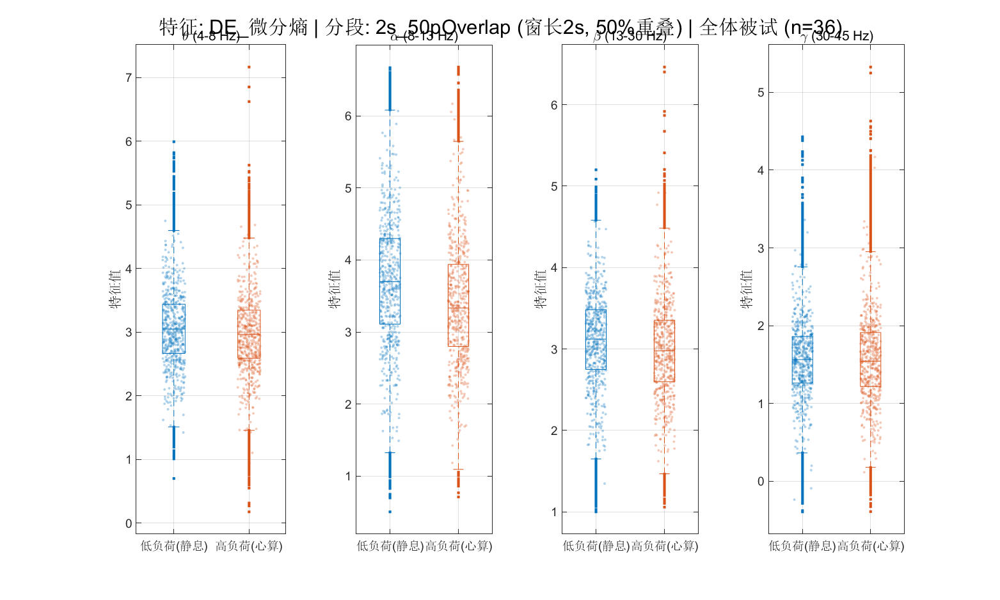
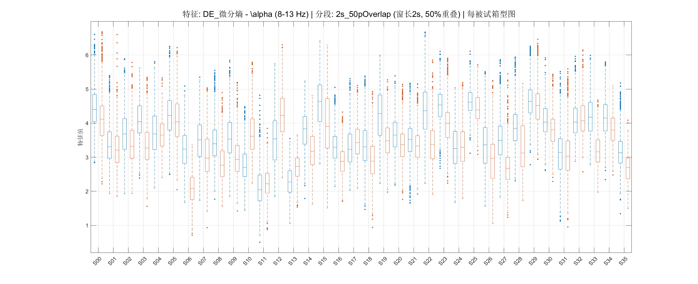

# EEG Mental Arithmetic Classification

[中文说明](README.zh-CN.md)

**Python V2 recommended mainline completed (2026-10-09).** The final stage adds finite unlabeled calibration, an explicitly defined reverse CORAL variant, source-fitted UMAP, 999 participant-block label permutations, feature statistics and EEGNet region perturbations. All 162 tests pass. On the same held-out suffix, primary-budget BA is **62.58% without calibration, 67.13% with diagonal standardization, and 60.11% with reverse CORAL**; negative transfer and statistical limitations are retained. See the [V2 final report](docs/v2-final-report.md), [stage 4 evidence](docs/v2-stage4-report.md) and [reproduction guide](python-v2/README.md). Optional DANN, additional ICA and external validation have not been implemented.

**Python V2, stage 3 (2026-10-09):** completed five resampling bridge experiments and all 36 participants × three prescribed EEGNet seeds. All 288 models passed independent audit and saved-model replay; 148 tests passed. EEGNet achieved **66.84% mean participant balanced accuracy**, macro-F1 0.6231 and AUC 0.7631. Its mean BA exceeded the 128 Hz LR/LDA/SVM controls, but all paired descriptive intervals included zero; no confirmed improvement is claimed. See the [full stage 3 report](docs/v2-stage3-report.md), [frozen protocol](docs/v2-stage3-protocol.md) and [reproduction commands](python-v2/README.md).

**Python V2, stage 2 (2026-10-08):** completed 18 experiments across 36 participants: isolated within-record evaluation, traditional model comparisons, feature/band/window ablations, and source-fitted PCA. See the [stage 2 report](docs/v2-stage2-report.md) and [reproduction commands](python-v2/README.md). These are exploratory comparisons; the original 2-second LR reference remains unchanged.

**Python V2, stage 1 (2026-10-07):** the independent [Python implementation](python-v2/README.md) now includes EDF provenance, interval-isolated splits, numerical validation and a nested 36-subject LOSO logistic-regression baseline. See the [stage report](docs/v2-stage1-report.md). The MATLAB V1 code and historical results below are preserved.

A MATLAB coursework project for classifying **resting-state vs. mental-arithmetic EEG** and comparing within-subject performance with generalization to unseen subjects.

The central observation is a large evaluation gap: saved within-subject test accuracies average **98.50–99.42%**, while leave-one-subject-out (LOSO) accuracies average **52.68–56.24%**. These results motivate further work on evaluation design and individual differences; they do not establish a reliable general-purpose cognitive-load detector.

## Pipeline

```text
Public EDF recordings (36 subjects, two conditions)
    → filtering, average reference, ICA + ICLabel
    → windowing (1 / 2 / 4 s; 0 / 50% overlap)
    → temporal and frequency-domain features
    → logistic regression / MLP / RBF SVM
    → within-subject testing and 36-fold LOSO
```

The implementation uses 19 EEG channels at 500 Hz and takes the first 60 seconds of each condition. Eight feature families are implemented: band-mean PSD, differential entropy (DE), log-energy, zero-crossing rate, kurtosis, skewness, mean and variance. The classification scripts select **2-second windows, 50% overlap and 76 DE features** (19 channels × four frequency bands), rather than combining all eight families.

## Saved results

Values below are arithmetic means over 36 subjects/folds, recomputed from the included CSV exports. F1 is computed for the mental-arithmetic positive class and then averaged across subjects; it is not a class-macro F1 score.

| Model | Within-subject test accuracy | Within-subject F1 | LOSO accuracy | LOSO F1 |
|---|---:|---:|---:|---:|
| Logistic regression | 99.42% | 0.9945 | 54.78% | 0.4606 |
| MLP | 98.96% | 0.9900 | 56.24% | 0.4824 |
| RBF SVM | 98.50% | 0.9849 | 52.68% | 0.3750 |

- **Within-subject:** a separate model for each participant; each condition is split chronologically into 60% training, 20% validation and 20% testing windows.
- **LOSO:** train on 35 participants and test on the remaining participant, repeated 36 times.
- Normalization statistics are fitted on the training partition.
- Within-subject MLP/SVM settings are selected using validation data; LOSO uses fixed settings. These are different protocols, not a single-variable ablation.

The repository packages an existing experiment. MATLAB was **not rerun during publication**, and the original software versions and complete run logs are not available. Current code settings have not been independently matched against every historical MAT result.

## Selected exploratory figures





These plots are descriptive. Their significance annotations inherit the statistical limitations described below.

## Files

| File | Purpose |
|---|---|
| `a2_preprocessing_main.m` | EDF import, filtering, average reference, ICA and ICLabel review |
| `a1_visualization.m` | Optional visualization of preprocessed EEG |
| `b1_segmentation_feature_extraction.m` | Six window configurations and feature extraction |
| `b2_visualization_statistics.m` | Exploratory plots and statistical comparisons |
| `c1_subject_dependent_classification.m` | Within-subject model selection and evaluation |
| `c2_loso_classification.m` | Leave-one-subject-out evaluation |
| `results/` | Original CSV exports, including per-subject metrics |
| `docs/methodological-notes.md` | Evaluation caveats and possible follow-up work |

## Running the project

1. Install MATLAB with Signal Processing Toolbox and Statistics and Machine Learning Toolbox. The classification code uses `fitcnet`, `fitclinear` and `fitcsvm`; use a MATLAB release that provides these functions. Exact original versions were not recorded.
2. Add EEGLAB to the MATLAB path, with ICLabel, FIRfilt and the DIPFIT standard channel-location file available. The preprocessing script resolves `plugins/dipfit/standard_BESA/standard-10-5-cap385.elp` relative to EEGLAB; adjust that path if your installation uses a versioned plugin directory.
3. Download the [EEGMAT dataset, version 1.0.0](https://physionet.org/content/eegmat/1.0.0/). Place its EDF files in the following layout, or edit `data_dir` in the preprocessing script:

   ```text
   eeg-mental-arithmetic-classification/
     a2_preprocessing_main.m
     eeg-during-mental-arithmetic-tasks-1.0.0/
       eeg-during-mental-arithmetic-tasks-1.0.0/
         Subject00_1.edf
         Subject00_2.edf
         ...
   ```

4. Open this repository in MATLAB and run these scripts in order:

   ```matlab
   a2_preprocessing_main
   b1_segmentation_feature_extraction
   b2_visualization_statistics
   c1_subject_dependent_classification
   c2_loso_classification
   ```

Preprocessing opens an ICA review dialog for each recording. Existing preprocessed files are skipped, so remove or relocate stale outputs yourself before changing preprocessing settings. Running the classification scripts replaces the corresponding saved exports. The scripts create intermediate directories as needed; EDF/MAT files are excluded from version control.

The publication copy replaces machine-specific project paths with paths relative to each script. Signal processing and modeling logic otherwise remain unchanged.

## Interpretation and limitations

- Rest vs. arithmetic is a **task-condition contrast**, not a validated continuous or multi-level cognitive-load measure.
- Overlapping windows are created before chronological splitting, so neighboring windows across split boundaries share raw samples. Filtering and ICA also precede the within-subject split. The high within-subject figures should not be interpreted as independent-session or deployment performance.
- LOSO means are close to the balanced binary baseline. No claim of statistically significant superiority to chance is made.
- Exploratory Welch tests pool correlated channels/windows. Their p-values do not establish population-level effects; subject-level paired or repeated-measures analysis is needed.
- DE and the implemented log-energy feature are affine transforms of the same band-power quantity for a fixed window length, except for numerical clipping.
- The public recordings were already preprocessed by their providers. This pipeline applies additional cleaning; the dataset's stated acquisition filtering also needs clarification before interpreting gamma-band findings.
- Failed MLP/SVM fits can fall back to all-negative predictions. Original logs should be checked before attributing every low-performing fold to physiology.

See [methodological notes](docs/methodological-notes.md) for follow-up ideas. These improvements are **not claimed as implemented**.

## Data attribution and reuse

Data source: **EEG During Mental Arithmetic Tasks**, contributed by Igor Zyma, Sergii Tukaev and Ivan Seleznov, distributed via PhysioNet. Dataset DOI: [10.13026/C2JQ1P](https://doi.org/10.13026/C2JQ1P). The dataset page specifies the **Open Data Commons Attribution License v1.0**. Raw recordings are not redistributed here; obtain them from the source and follow its terms.

Please cite the original study when using this dataset:

> Zyma I, Tukaev S, Seleznov I, Kiyono K, Popov A, Chernykh M, Shpenkov O. Electroencephalograms during Mental Arithmetic Task Performance. *Data*. 2019;4(1):14. [doi:10.3390/data4010014](https://doi.org/10.3390/data4010014).

Also use the PhysioNet citation requested on the [dataset page](https://physionet.org/content/eegmat/1.0.0/): Pollard et al. (2026), *PhysioNet as a global platform for biomedical research*, Nature Health, [doi:10.1038/s44360-026-00096-z](https://doi.org/10.1038/s44360-026-00096-z).

EEGLAB, ICLabel and MATLAB are external dependencies with their own licenses. No additional software license is granted by this repository at this time.
