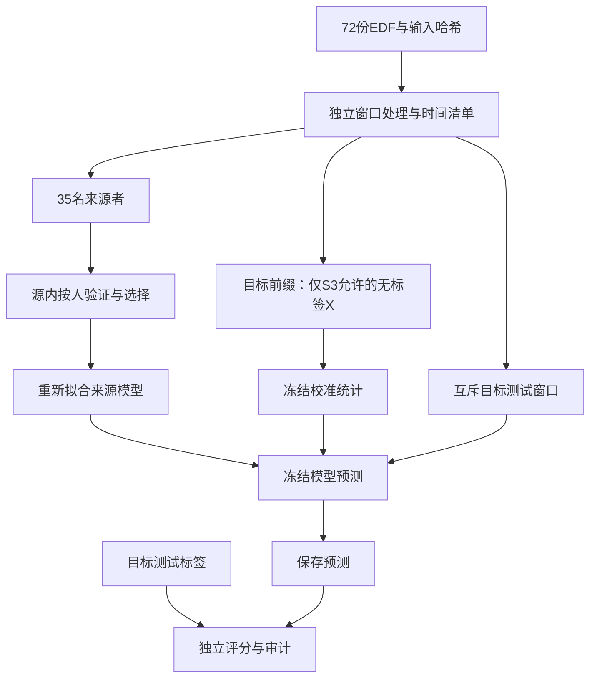

# EEG Python V2 加强版总报告

完成日期：2026-10-09。**原规划的推荐完整版主线已完成并通过审计。**保留MATLAB V1，另建Python V2，完成数据审计、时间与被试隔离、传统模型、消融、PCA/UMAP、EEGNet、有限无标签校准、CORAL变体、统计及模型解释。DANN、额外ICA和外部数据验证是未实施的选做扩展，不作为已完成贡献。

## 研究问题和核心发现

本项目使用公开EEGMAT的36名被试、72份记录，比较静息与心算。重点是模型对未见个体的泛化，以及在明确限制目标数据访问后，少量无标签校准是否有价值。

第一，评估场景决定成绩含义。Python V2同记录时间隔离的LR/LDA/SVM平均BA为86.67%/91.39%/86.11%，而无目标校准、未见被试的同类基线为63.06%/65.23%/63.52%。高被试内成绩没有自动转化为跨人泛化。MATLAB历史成绩约99%与V2的处理、特征、重叠和选参同时不同，不能把差异归因于单个“防泄漏修复”。

第二，学习时空表征提供了有限、异质的收益。全部36人×3固定种子的EEGNet平均BA为66.84%，macro-F1为0.6231，AUC为0.7631。相对128 Hz传统对照的BA配对描述区间均跨零，不宣称确认性优越。更复杂模型并未消除个体差异。

第三，有限校准中的简单方法值得保留。固定共同测试后缀和每记录10秒主预算时，对角统计标准化BA为67.13%，不校准为62.58%，反向CORAL为60.11%。标准化的BA均值提升4.55个百分点，但AUC略降，Holm校正p约0.0548；CORAL在当前规则下未增加收益。这不是所有域适应方法的普遍结论，保留其方向、正则、短样本与时段漂移限制。

## 不混淆的主结果表

所有结果来自同一批36人。BA先逐被试计算，再等权平均；EEGNet先在同一人内平均三个种子指标。

| 场景与配置 | 允许的目标数据 | 每人测试窗 | 种子 | 平均BA | 解释 |
|---|---|---:|---|---:|---|
| S1：时间隔离LR | 本人先前训练/验证块及其标签 | 10 | 42 | 86.67% | 同记录，不是跨会话 |
| S2：500 Hz DE+LR | 不校准，仅当前预测窗口 | 60 | 42 | 63.06% | 源内3折选C |
| S2：128 Hz DE+LR | 不校准，仅当前预测窗口 | 60 | 42 | 62.92% | 降采样桥接 |
| S2：128 Hz EEGNet | 不校准，仅当前预测窗口 | 60 | 13/42/2026 | 66.84% | 108模型全部保留 |
| S3：DE+LR不校准 | 不使用目标前缀 | 36 | 42 | 62.58% | 共同24—60秒后缀，源侧模拟选C |
| S3：对角标准化+LR | 每记录10秒前缀，合计20秒、10窗，无标签 | 36 | 42 | 67.13% | 8/36人较不校准下降 |
| S3：反向CORAL+LR | 与上一行相同 | 36 | 42 | 60.11% | 15/36人较不校准下降 |

不同场景不是同一排行榜。S3采用独立的前缀/后缀模拟选参，不能直接将其成绩与S2整段成绩相减来宣称校准收益。S3中适配器不知道标签，但划分器知道两个条件记录的边界和前缀覆盖先验。

## 可审查的信息流

模型侧只接收对应阶段允许的数组。标签、文件名和条件元数据不进入目标适配器；测试后缀不用于目标均值/协方差估计。供应方原有清洗无法撤销，因此表述为“控制了本项目新增处理的信息流”，不保证从采集开始绝对无泄漏。

## 统计、解释和复现证据

- 固定C=1的S2 LR完成999次整被试条件交换，每次重新拟合36折；观察BA60.65%，空分布均值49.91%，加一p=0.001。它只检验这一固定C流程，受可交换性与条件顺序混杂限制，不是EEGNet的显著性检验。
- 57个通道×频段按每人条件均值差分析，保留效应量、配对区间与BH-FDR；39项q<0.05不构成已验证生物标志物。
- PCA与UMAP均来源拟合、目标投影，保留3个事前指定目标，不挑漂亮图；图形显示的异质性是描述性证据。
- 108个EEGNet模型完成5脑区、共540次输入扰动，记录全部个体与种子。置零有分布外风险，脑区通道数不同，绝对权重不是脑激活图。
- 162项自动测试全部通过。阶段二648模型、阶段三288模型、阶段四252模型/适配组合分别审计通过；第一阶段36折参考也完整保留。这些数量是实验重复，不是新增受试者。
- 代码、配置、文件哈希、源侧候选分数、逐窗预测、模型重放与失败记录可追查。原始数据、环境、中间数组和模型权重不随GitHub分发。

## 完成范围与局限

| 原加强方向 | 完成证据 |
|---|---|
| 数据/时间隔离与训练侧拟合 | 阶段一数据审计、S1/S2协议、目标扰动测试；S3前后缀隔离 |
| 特征与窗口消融 | 阶段二18组实验与原参考逐点核对 |
| PCA/UMAP | 来源拟合、固定3个外层目标、坐标与检查记录 |
| EEGNet | 三种子108个组合、源侧选轮数、冻结BN/Dropout测试状态 |
| 域适应 | 对角校准与明确方向的CORAL变体，三种预算、共同后缀、负迁移分析 |
| 统计与解释 | 配对区间、近似符号翻转与Holm、固定LR置换、特征FDR、区域扰动 |

仍有无法通过增加算法解决的数据限制：每人每条件单条记录、固定静息先于心算、无文本事件确认任务起点、供应方清洗和缺少跨会话/外部数据验证。当前任务是静息与心算二分类，不能扩写为临床诊断、连续认知负荷或已部署在线系统。

DANN未启动。本轮推荐完整版以可复核的EEGNet与有限线性校准闭环验收；增加DANN需要另立同骨干λ=0、三种子和源侧选择预算。额外ICA桥接和外部验证也保留为后续独立实验，完成状态不依赖正面结果或某一准确率门槛。

## 文件入口

[第一阶段](v2-stage1-report.md)｜[第二阶段](v2-stage2-report.md)｜[第三阶段](v2-stage3-report.md)｜[第四阶段](v2-stage4-report.md)｜[复现命令](../python-v2/README.md)｜[申请材料事实包](v2-application-brief.zh-CN.md)。
