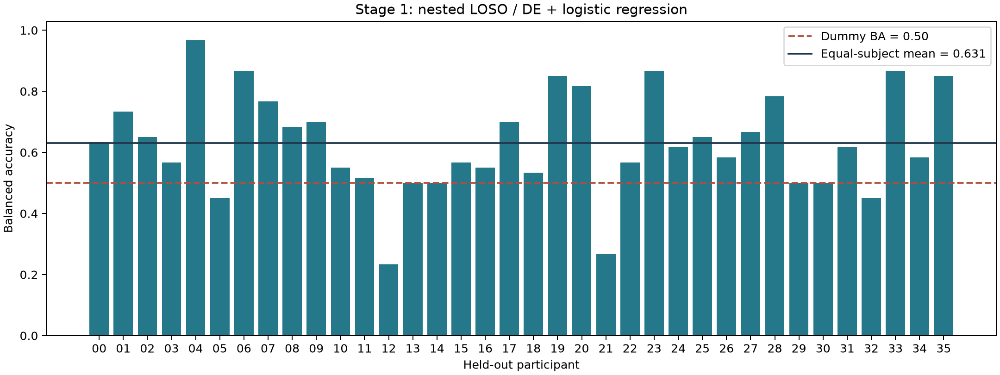
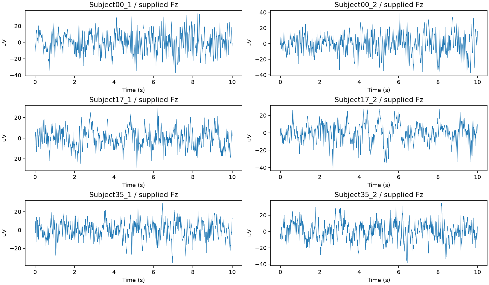
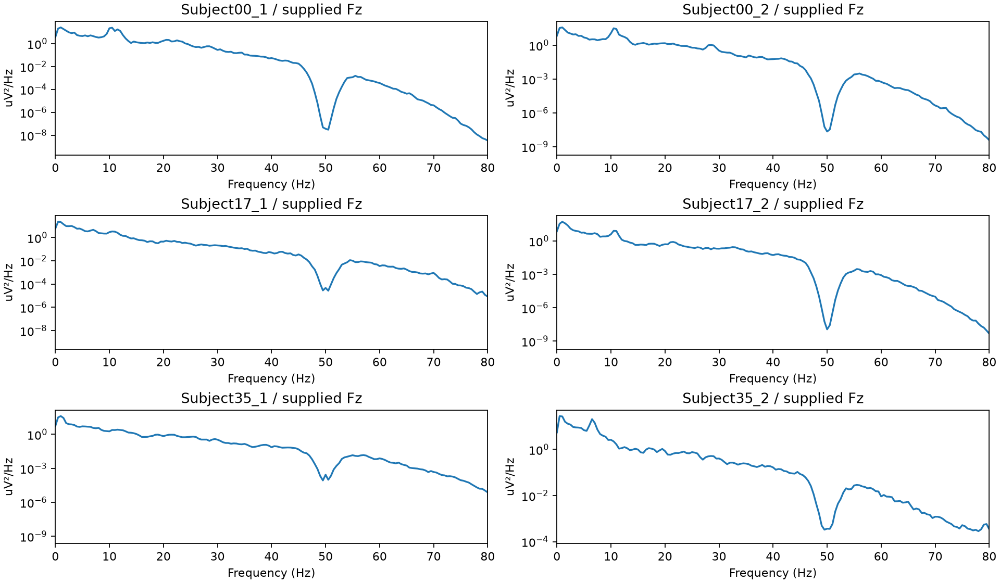

# Python V2 第一阶段：可信基线实施报告

日期：2026-10-07。代码入口：[运行说明](../python-v2/README.md)；冻结配置：[stage1.json](../python-v2/configs/stage1.json)。

## 本次交付

已完成第一阶段的数据、划分、特征、验证和首轮 LR 跨被试实验。独立 Python 3.12.14 环境已建立，依赖版本写入 `python-v2/requirements-lock.txt`。MATLAB V1 六个脚本没有改动。

S2 主结果采用 36 折 LOSO，全部成功；每折 35 名源被试内部进行 3 折按人分组验证。主指标为验证被试 balanced accuracy 的等权均值，选择 LR 的 C∈{0.01, 0.1, 1, 10}，平局选较小 C。标准化在每次内层训练集上拟合；选参后在 35 名源被试重新拟合，目标被试只用于最终预测和评分。

## 结果

| 项目 | 实际值 |
|---|---:|
| 成功外折 | 36 / 36 |
| 独立测试被试 | 36 |
| 逐窗口预测 | 2160（每人 60，静息/心算各 30） |
| 被试等权平均 balanced accuracy | **63.06%** |
| 被试等权平均 accuracy | 63.06% |
| 被试等权平均类别 macro-F1 | 0.5844 |
| 被试等权平均心算正类 F1 | 0.5604 |
| 被试等权平均 ROC-AUC | 0.7552 |
| Dummy 平均 balanced accuracy | 50.00% |
| 被试 BA 中位数 | 61.67% |
| 被试 BA 范围 | 23.33%—96.67% |

每人两类样本数相等，因此本次 accuracy 和 balanced accuracy 相等。AUC 使用连续概率；固定 0.5 阈值下的 F1 与 AUC 含义不同，不能用 AUC 替代分类正确率。

结果来自冻结的首轮配置，不按测试成绩选择频段、窗口或种子。3 个预先指定技术验证对象为 Subject00、Subject17、Subject35。它们的预测也保留在本地技术验证目录中。

28 人的 BA 高于 50%，4 人恰为 50%，4 人低于 50%。36 折都由源侧验证选择了 C=0.01；这是当前候选集合的结果，不据外层成绩扩展参数范围。当前机器单线程 BLAS 下，36 折记录的训练与保存总用时约 70.2 秒（不含环境安装、数据准备及最终汇总核验）。

与 V1 的 LR LOSO accuracy 54.78% 相比，当前数值较高，但**不是控制单一变量的提升证据**：预处理、频段、重叠和调参协议同时发生了变化。不能将差值归因于防泄漏措施或某个算法，更不能以此宣布显著改善。LOSO 的训练集高度重叠，未将折数当独立重复训练次数计算普通置信区间或显著性。

## 数据与预处理边界

- 72 份 EDF 全部成功解码；按名称选择 19 导联，核验 500 Hz 和 µV。原始文件 SHA-256、通道头部和裁切边界逐条保存，元数据不导出患者、记录身份或日期。
- 所有 EDF 注释都没有文字事件，无法据此确认实际任务起点。主分析固定取前 60 秒，作为可复现的 V1 对接规则，不声称是已经验证的精确任务区间。
- 每条 60 秒生成 30 个互不重叠的 2 秒窗；共 2160 个窗口、57 个 DE 特征（19 导联×θ/α/β）。频段为闭区间，与 V1 公式保持兼容；零填充至下一个 2 的幂，保留正确的单边谱缩放。
- 在当前窗口内做瞬时平均参考和时间去均值；不新增时间滤波、重采样或 ICA。平均参考不利用未来时刻；窗口去均值只利用当前输入窗口。标准化使用源训练集，标准差定义为 ddof=0，与 MATLAB 默认样本标准差的定义差异已记录。
- 供应方已做过 ICA 等清洗；25/72 文件 EEG 头部有 0.5—45 Hz/50 Hz 滤波记录，47 份空白。V2 无法撤销或证明供应方原处理的时间隔离，只能保证本项目新增操作遵守已声明的数据边界。gamma 暂不纳入主特征。
- 每人每条件仅一条记录，静息先于心算；条件与记录/采集顺序相伴，当前数据不足以彻底分离任务状态、记录差异和时间漂移，也未提供跨会话或外部数据验证。
- 全部所选片段数值有限，无完全平线通道，重复极值启发式未触发可能削顶标志。这不等同于没有任何伪迹，也不证明放大器从未饱和。保留全部被试，未按成绩删人或挑片段。

代表性检查固定使用 Subject00、17、35 的两个条件：

## 防泄漏与数值验证

自动测试覆盖 EDF 校准/单位、通道顺序、异常输入、Parseval、已知正弦、DC/Nyquist、频段端点、DE/LEE 关系、窗口回溯、时间块隔离、被试隔离、未来片段扰动不改变训练特征、目标输入/标签扰动不改变源模型，以及训练失败不伪装为 Dummy。

保存预测的独立核验检查窗口唯一性、测试窗口完整性、内外层被试无交叉，并重新计算每人指标。每折保存拟合对象、参数候选及所有内层被试分数、拟合窗口清单、预测概率；失败会单列状态和异常，不能以全负类预测替代。

本次 **78 项自动测试全部通过**。另外的[独立验收](../results/v2-stage1/independent_audit.json)共14项通过：直接从预测用混淆矩阵与秩统计重算指标，并检查432个参数候选×内层折的分组。技术验证的180条概率与正式实验对应预测逐点相同，最大差为0。

实际运行 MATLAB R2024a，与 Python 对同一组实测片段比较：3 份 EDF 的 0、20、40 秒起始片段，共 9×19×4=684 个 DE 值。最大绝对误差 **8.88×10⁻¹⁶**；频带功率最大绝对误差 **2.84×10⁻¹⁴ µV²**。这是同输入公式一致性核验，不是完整 V1/V2 处理链等价性声明。

另只读核查了全部 72 份遗留 MAT：均为 `19×1000×30`，采样率 500 Hz，共 30000 点；epoch 时间为 0—1998 ms。2088 个相邻 epoch 边界没有完全相同的 19 通道端点向量。**没有发现原先担忧的每 epoch 1001 点导致额外重复这一现象。**这仍不足以重建上游全部原始时间戳，不能由数组尺寸推断供应方与旧预处理完全连续。

## S1 与尚未实施部分

S1 当前完成时间划分清单和隔离测试，**尚未训练或报告 S1 分类成绩**。每条 60 秒记录按半开区间划为训练 [0,31.2)、验证 [35.2,45.6)、测试 [49.6,60) 秒，两处各留 4 秒间隔；扣除间隔后按 60/20/20 分配。每块仅取完整 2 秒窗，因此实际为 15/5/5 个窗口，尾部不足一窗的数据不补齐。清单共 1800 窗。

4 秒间隔针对当前没有附加时间滤波的处理链和计划中的最长 4 秒窗；未来加入滤波器必须重新计算支持范围及裁边。这个场景只是同记录后续片段，不是跨会话或整次实验全局在线预测。

下一阶段先补 S1 对照与 LDA/SVM，再按冻结的单因素方案做频段、特征和窗口消融、PCA 分析。EEGNet、有限目标校准、CORAL 和 DANN 尚未实施，不纳入本次成果描述。

## 证据与复现

- [逐被试结果](../results/v2-stage1/subject_metrics.csv)、[逐窗预测](../results/v2-stage1/predictions.csv)、[汇总](../results/v2-stage1/summary.json)、[预测核验](../results/v2-stage1/verification.json)。
- [运行配置与环境](../results/v2-stage1/run.json)、[数据及源码指纹](../results/v2-stage1/manifest.json)、[遗留 MAT 与 MATLAB 对照证据](../results/v2-stage1/legacy_validation.json)。
- 本地完整产物：`python-v2/outputs/prepared-stage1`、`smoke-stage1`、`loso-stage1`、`legacy_validation`。源码、配置、输入 SHA 和环境参与数据集指纹；不按“文件已存在”复用旧特征。每次命令要求新的输出目录，以防覆盖。
- 当前数据集指纹：`6b401d30d169cd3877c2257c764d15dd156e571d72dc910991685de3ddcaf5e3`。

## 可用于申请材料的表述

“我将已有 MATLAB 脑电分类项目重构为可追溯的 Python 实验流程，针对训练测试时间交叉、跨被试选择偏差与特征数值一致性建立了检查。在 36 名被试的嵌套 LOSO 评估中，首轮 DE 逻辑回归达到 63.06% 的平均 balanced accuracy，同时暴露出较大的个体差异。这促使我把下一步重点放在受控消融与跨被试泛化机制分析，而非仅追求被试内高准确率。”

这段表述对应本次已完成工作；不能提前写成已实现深度域适应、已达到临床有效性或已证明新模型优于既有研究。
