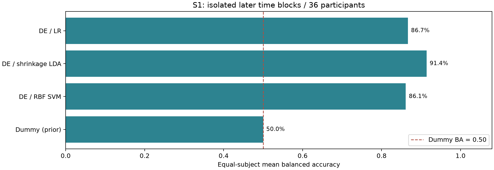
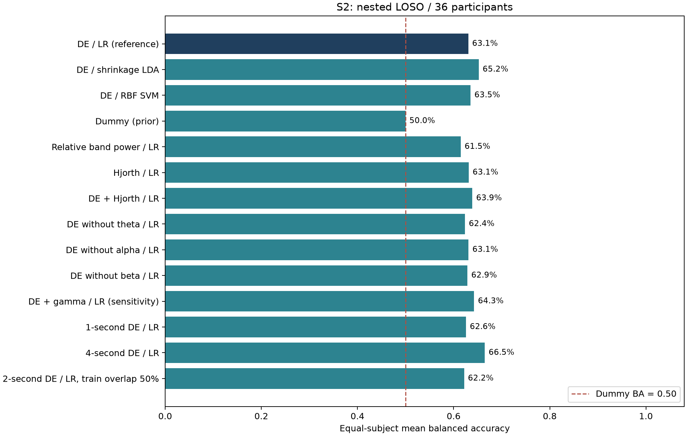
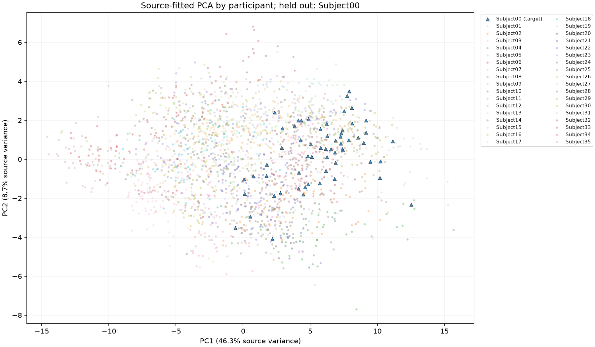
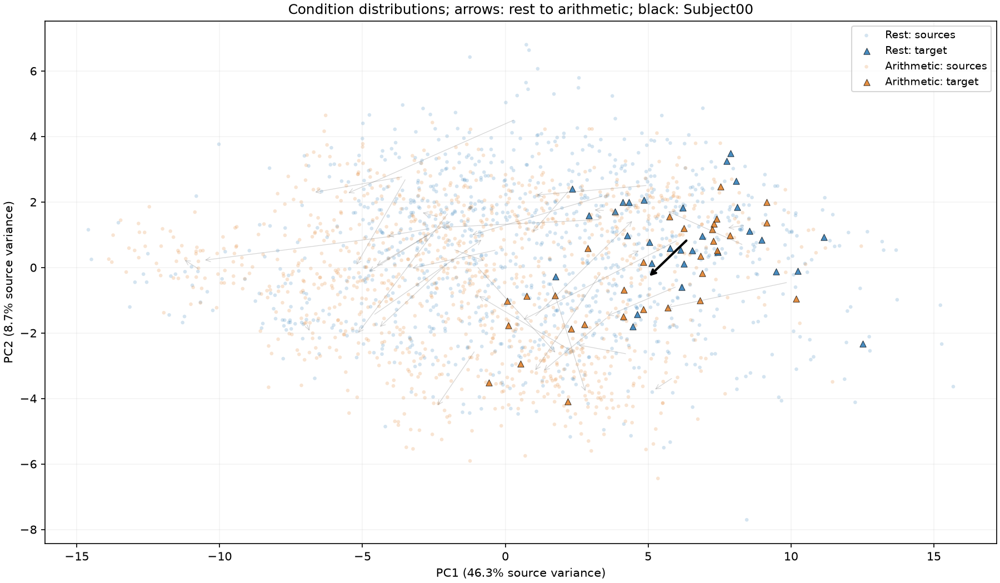

# Python V2 第二阶段：传统对照、消融与跨被试差异

日期：2026-10-08。方案在观察本阶段成绩前冻结，见 [stage2.json](../python-v2/configs/stage2.json)。执行入口与完整命令见 [Python 说明](../python-v2/README.md#第二阶段复现)。

## 完成范围与主要结论

完成 **14 组 S2 跨被试实验、4 组 S1 时间隔离实验，共 648 次被试级评估**，全部成功。保存 32,760 条预测记录；这些是同一批 36 名被试在不同实验中的重复评估，不能当作 32,760 个独立样本。完成 137 项自动测试，以及预先指定 Subject00、Subject17、Subject35 的来源训练 PCA。

相同的 2 秒、57 维 DE 特征下，跨被试 LR、LDA、SVM 的平均 balanced accuracy 分别为 **63.06%、65.23%、63.52%**。S1 同记录后续时间块的对应结果为 **86.67%、91.39%、86.11%**。控制本项目新增处理边界后，被试内与跨被试差距依然存在。

消融中，4 秒窗 LR 的描述性均值为 **66.48%**，值得后续验证；增加特征或训练窗重叠没有表现出一致收益。这些结果用于理解取舍，不据外层均值重新指定“最优确认性模型”。原 2 秒 DE+LR 参考保留，其 2160 条概率与第一阶段逐点完全相同。

## 评估方法

数据仍为同一批 72 份 EDF：19 导联、500 Hz、每条件前 60 秒。全部源文件 SHA 与第一阶段核对一致。处理仍是单窗口平均参考和去均值，没有新增 ICA、时间滤波、目标校准或质量筛选。

| 项目 | S1：同记录后续时间块 | S2：无目标校准 LOSO |
|---|---|---|
| 外层测试对象 | 同一人的后续片段 | 完全留出的 1 人 |
| 训练数据 | 每人每条件 15 个窗口，共30窗 | 其余35人，标准2秒配置共2100窗 |
| 选参 | 每人验证块10窗的 BA | 源侧3折 GroupKFold，验证被试 BA 等权均值 |
| 测试数据 | 每人10窗，两类各5窗 | 标准2秒配置每人60窗，两类各30窗 |
| 最终拟合 | 仅训练块；不合并验证块 | 全部35名源被试 |
| 标准化 | 每个候选只在训练块拟合 | 每内折训练源被试拟合；最终在35源被试拟合 |

S1 原始块为 [0,31.2)、[35.2,45.6)、[49.6,60) 秒，块间各4秒隔离；不足完整窗口的尾部不补齐。S1 每人的测试仅10窗，分数较离散。它既不是跨会话评估，也不是整次实验全局严格在线预测。

LR 的 C∈{0.01,0.1,1,10}；LDA 使用 `lsqr`，收缩系数候选为 `auto`、0.1、0.5；RBF SVM 的 C∈{0.1,1,10}，gamma=`scale`。按预先声明顺序处理并列最佳值。Dummy 为训练集类先验模型：此处两类均衡，概率0.5，固定阈值约定使其预测心算。

SVM 不启用概率校准，保存原始 `decision_margin`，阈值为0；其他模型保存心算概率，阈值0.5。AUC 使用对应连续分数，不将 SVM margin 称为概率。

## 相同特征下的模型对照

指标均为36名被试等权平均，BA=balanced accuracy。由于每人的测试类数相等，accuracy 与 BA 相同。

| 模型（2秒 DE） | S1 BA | S1 macro-F1 | S2 BA | S2 macro-F1 | S2 AUC |
|---|---:|---:|---:|---:|---:|
| LR | 86.67% | 0.8623 | 63.06% | 0.5844 | 0.7552 |
| 收缩 LDA | 91.39% | 0.9118 | 65.23% | 0.6050 | 0.7703 |
| RBF SVM | 86.11% | 0.8578 | 63.52% | 0.5813 | 0.7748 |
| Dummy | 50.00% | 0.3333 | 50.00% | 0.3333 | 0.5000 |

LDA 的 S2 均值比 LR 高2.18个百分点，20人提高、5人相同、11人下降；SVM 高0.46个百分点，19人提高、5人相同、12人下降。非线性 SVM 没有体现出稳定的大幅优势。S1 的高成绩也没有消除跨被试泛化问题。

不要将本次 S1 与 V1 的约99%成绩直接解释为防泄漏修复的单因素效果：频段、窗口重叠、附加预处理、模型选择和测试窗口数量同时不同。当前尚未完成“只改变一个旧处理环节”的完整 V1 桥接实验。

## 单因素消融

所有消融使用 LR，相对参考配置只改变表中因素；每个实验仍独立在源侧选择 C。没有把多种因素组合成大规模搜索，再按外层成绩选一个赢家。

| 配置 | 维度 | 平均 BA | 相对2秒DE+LR变化（百分点） |
|---|---:|---:|---:|
| 参考：2秒 θ/α/β DE | 57 | 63.06% | 0.00 |
| 相对频带功率 | 57 | 61.48% | −1.57 |
| Hjorth | 57 | 63.15% | +0.09 |
| DE+Hjorth | 114 | 63.89% | +0.83 |
| 去掉 θ | 38 | 62.36% | −0.69 |
| 去掉 α | 38 | 63.10% | +0.05 |
| 去掉 β | 38 | 62.87% | −0.19 |
| 加入 γ（敏感性分析） | 76 | 64.26% | +1.20 |
| 1秒窗 | 57 | 62.57% | −0.49 |
| 4秒窗 | 57 | 66.48% | +3.43 |
| 仅训练窗50%重叠 | 57 | 62.18% | −0.88 |

**特征定义。**相对功率的分母是单次4—30 Hz积分，不是三个共享边界频段的功率之和；分母为零时返回零。Hjorth 为每导联的 `log2(var+1e-15)`、mobility、complexity，方差使用ddof=0，差分按采样点定义，不乘采样率；零分母项返回零。DE+Hjorth 按两个特征块拼接。Hjorth 使用当前输入窗口的宽频信号，其含义不能等同于仅 θ/α/β 的带内信息。

**时间窗比较。**1、2、4秒方案都覆盖每条件同一 [0,60) 秒。每人的测试窗分别为120、60、30；每个外折训练窗分别为4200、2100、1050。4秒窗不仅改变频谱估计，还改变样本数与一次决策所需数据长度；不能把差异只解释为某一频率机制，也不能据此断言实际在线系统更好。

**重叠比较。**仅训练池从每折2100增至4130窗，内层验证与外层测试的特征、窗口ID和边界保持完全一致。结果为6人提高、16人相同、14人下降，当前没有平均收益。新增高度相关窗口不是新增独立被试；训练样本数也会改变 LR 损失与正则化的相对作用。

**频段解释。**逐频段移除的均值变化较小，不能推出某频段“无关”或作神经机制定位。γ 仍单列敏感性结果，因为供应方滤波来源信息并未补齐；它不能因均值略高就进入主确认性配置。

## 逐被试配对描述与不确定性

按同一被试配对 BA 差值，以被试为单位做5000次 bootstrap，seed=42；报告均值差、胜平负、配对标准化效应量dz和百分位区间。没有按时间窗重采样，没有把648次评估当作648名独立受试者。

以下区间是**固定这些已保存预测后的探索性、条件性描述**。它不包含重新训练的不确定性，不修正比较多个方案带来的选择问题，也不能把训练集高度重叠的 LOSO 当成独立重复试验。因此本阶段不作确认性 p 值或“显著优于”的声明。

| 与2秒DE+LR比较 | 平均差（百分点） | 条件性95%描述区间 | 提高/相同/下降人数 |
|---|---:|---:|---:|
| LDA | +2.18 | [−0.05, +4.54] | 20 / 5 / 11 |
| SVM | +0.46 | [−3.24, +3.80] | 19 / 5 / 12 |
| DE+Hjorth | +0.83 | [−2.04, +3.66] | 14 / 9 / 13 |
| 4秒窗LR | +3.43 | [+1.34, +5.69] | 19 / 9 / 8 |
| 仅训练窗50%重叠 | −0.88 | [−1.76, 0.00] | 6 / 16 / 14 |

重叠实验区间上界在浮点结果中约为−2.46×10⁻¹⁵个百分点，应解释为零，不能据数值舍入判定显著负向效果。完整13组配对描述及逐人差值见 [paired_descriptive.json](../results/v2-stage2/paired_descriptive.json)。

## PCA 与跨被试几何差异

预先指定 Subject00、17、35，分别只用另外35人的2100个窗口拟合 StandardScaler 和二维 PCA，再投影目标的60个窗口。标签只用于着色和条件中心描述，不进入拟合或模型选择。每次投影按被试和条件分别着色，保留同人静息→心算中心差箭头。

| 留出对象 | PC1解释源方差 | PC2解释源方差 | 两维合计 |
|---|---:|---:|---:|
| Subject00 | 46.31% | 8.70% | 55.01% |
| Subject17 | 47.01% | 8.55% | 55.56% |
| Subject35 | 47.19% | 8.08% | 55.27% |

两个条件在投影中有广泛重叠，不同人的中心和条件差方向也有差异。二维图仅保留约55%的来源方差，不能用其可见分离度证明模型泛化，也不能从按人着色的分组直接推出模型“只记住身份”。

为避免只看二维图，另保存原57维来源标准化空间中的条件差向量、中心距离与方向余弦。在上述三次来源划分中，35名源被试的中心到来源中心的距离RMS约5.77—5.79，同人的条件中心差长度均值约4.60—4.67。条件差向量相对来源平均方向的平均余弦约0.44—0.46，其中4—5名源被试为负。这些是几何描述，来源参考本身包含该被试的贡献；不能将它们当作无偏检验或个体差异的因果证据。

另外两组图和坐标见 [Subject17](../results/v2-stage2/pca_Subject17/summary.json)、[Subject35](../results/v2-stage2/pca_Subject35/summary.json)。不同来源划分的 PCA 坐标轴分别拟合，不宜直接叠加比较绝对坐标。

## 验收与保留的局限

- 全部18组×36人成功，失败数0；保存每折模型、参数候选、参与拟合的窗口ID、逐窗分数和被试级结果。
- 137项自动测试通过，包括新特征公式、源侧选参、目标扰动、SVM分数语义、失败状态、S1 CSV区间往返与防交叉检查。
- 参考 DE 特征、元数据及2160条参考 LR 概率与第一阶段完全一致，最大概率差0。训练重叠实验的评估池也与参考逐点相同。
- 独立审计从混淆计数和秩统计复算全部32,760条预测，核查5508个内层候选折；读取648个本地产生的模型核对训练均值并重放预测，最大分数误差0。2730条技术验证分数与全量对应结果完全一致，三组PCA的源侧拟合和坐标也通过核验。
- 技术验证最初在S1的CSV复核器遇到“字符串索引未转整数”的错误。已修复并新增回归测试；旧失败记录保留，S1在新目录重跑技术验证通过。未改变数据、候选参数或评分方案。
- 供应方已清洗数据的时间边界无法撤销；任务起点无文字事件可确认，仍取前60秒。每人每条件仅一条记录，静息先于心算，记录身份和时间顺序混杂尚不能完全分离。
- 本阶段没有实现额外ICA桥接、UMAP、EEGNet、CORAL或DANN；不能提前把这些写作已完成贡献。

## 下一阶段的执行顺序

1. 保留2秒DE+LR作为锚点，将LDA、SVM和4秒结果作为完整对照；后续方案选择继续放入源侧验证，不能按本阶段外层均值宣布最佳配置。
2. 先验证降采样/抗混叠对传统参考的影响，再实现EEGNet输入、训练和测试状态检查；固定13、42、2026三种子，早停仅使用来源验证数据。
3. EEGNet通过后再进入有限无标签目标校准：固定预算和共同测试后缀，先做简单目标标准化，再做CORAL，最后决定是否启动DANN。

## 文件入口与申请材料

[汇总CSV](../results/v2-stage2/experiment_summary.csv)｜[配对描述](../results/v2-stage2/paired_descriptive.json)｜[分析核验](../results/v2-stage2/analysis.json)｜[独立结果审计](../results/v2-stage2/independent_audit.json)｜[测试记录](../results/v2-stage2/tests.xml)。各实验的逐人指标、逐窗预测和复核结果在 `results/v2-stage2/experiments/`，模型保留在本地 `python-v2/outputs/runs-stage2/`。

准备数据指纹：`40eb85b1681c063851deeaec2f63b374931f1f6d4a3aefab721f7e5a8c4fa124`。数据准备与模型运行分别保存源码指纹；S1复核器的修复发生在两者之间，其余处理与冻结实验规则保持一致。

可据实表述为：“在建立可追溯的脑电评估流程后，我完成了传统模型、特征和时间窗的受控比较。结果显示，增加模型复杂度或特征数量并不自动改善跨被试表现；同记录评估与未见被试评估仍存在明显差距。我进一步使用来源训练PCA和逐被试配对分析，记录了个体分布及条件差方向的异质性，为后续验证学习表征和有限校准提供了可复核的对照。”

这比单列最高准确率更能呈现研究判断；不将探索性均值、PCA图形或条件性区间包装成已经证明的跨人群泛化或神经机制结论。
