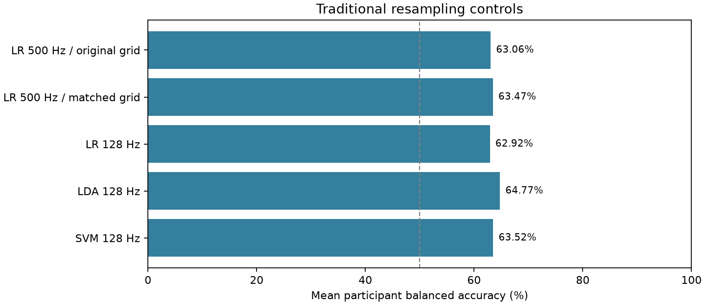
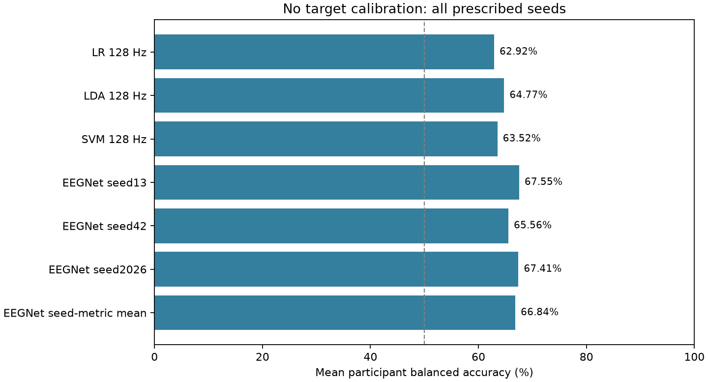
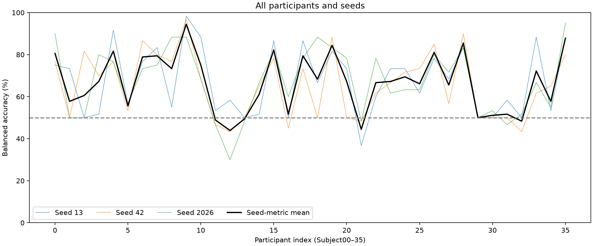
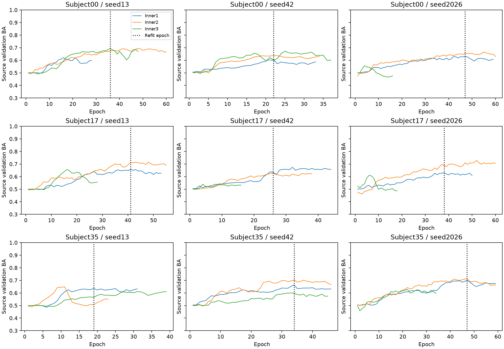

# Python V2 第三阶段：降采样桥接与 EEGNet

报告生成时间（北京时间）：2026-10-09T16:01:58.553604+08:00。实验方案冻结于2026-10-08，见[协议与资源调整](v2-stage3-protocol.md)。

## 已完成的传统桥接

5组×36人全部完成，180个保存模型和10,800条预测通过独立审计，模型重放最大误差为0。原500 Hz LR的2160条概率与第一阶段完全相同。

| 配置 | 平均BA | macro-F1 | AUC |
|---|---:|---:|---:|
| LR 500 Hz / original grid | 63.06% | 0.5844 | 0.7552 |
| LR 500 Hz / matched grid | 63.47% | 0.5881 | 0.7560 |
| LR 128 Hz | 62.92% | 0.5820 | 0.7482 |
| LDA 128 Hz | 64.77% | 0.6001 | 0.7730 |
| SVM 128 Hz | 63.52% | 0.5808 | 0.7614 |

降采样前后LR均值接近，但这不证明两种处理等价。500 Hz参考使用1024点FFT，128 Hz使用256点FFT；增加500 Hz/1000点FFT对照，单独记录频率网格变化。

网格变化的DE绝对差中位数为0.05250；在相同0.5 Hz网格下，降采样相关绝对差中位数为0.00305。这些是当前数据的数值描述。

固定抗混叠FIR和10/30/100/150 Hz合成信号检查通过。反射只使用本2秒窗的数据；内部幅值与全窗RMS分别保存，边缘效应仍是局限。网络采用宽频时域输入，DE使用4—30 Hz特征，因此比较同时涉及表征与分类器。

## EEGNet 状态

**36人×3种子全部完成，108个EEGNet模型和6480条预测通过复核。**先对每人的三个种子指标取均值，再对36人等权平均。

| EEGNet种子 | 平均BA | macro-F1 | AUC |
|---|---:|---:|---:|
| 13 | 67.55% | 0.6253 | 0.7654 |
| 42 | 65.56% | 0.6102 | 0.7651 |
| 2026 | 67.41% | 0.6339 | 0.7587 |
| 三种子指标均值 | 66.84% | 0.6231 | 0.7631 |

三个种子不是新增被试；这里没有进行概率集成，也没有挑选最好种子。EEGNet的平均BA较高，但其AUC低于LDA 128 Hz；结果不支持在所有指标上都占优的结论。

最终重训轮数为17—52，中位数28.5；324个内层训练中有50次达到60轮上限。触及预算不代表已充分收敛。

| 配对比较 | 平均差（百分点） | 条件性95%描述区间 | 提高/相同/下降 |
|---|---:|---:|---:|
| EEGNet均值 − LR 128 Hz | +3.92 | [-0.22, +8.46] | 20/1/15 |
| EEGNet均值 − LDA 128 Hz | +2.07 | [-1.91, +6.10] | 18/2/16 |
| EEGNet均值 − SVM 128 Hz | +3.32 | [-0.88, +7.81] | 18/1/17 |

区间使用固定已保存预测做5000次被试配对bootstrap，不包含重新训练不确定性或探索性多重比较校正；LOSO训练集高度重叠，不据此宣布确认性显著提升。

曲线的代表被试在成绩产生前指定，显示的是来源验证而非目标成绩；其他折逐轮均值与训练损失也随CSV保存。

独立审计从混淆计数和秩统计复算指标，核对源侧标准化、内层划分和轮数选择，并重放全部保存模型。288个模型的重放最大误差为0，见[完整审计](../results/v2-stage3/independent_audit.json)。148项自动测试通过，包括窗口隔离、目标数据与标签扰动不改变训练、来源标准化、BN/Dropout测试状态及失败处理，见[测试记录](../results/v2-stage3/tests.xml)。

## 解释边界与文件

本轮采用已声明的CPU预算与本地PyTorch实现，不宣称网络充分调优或与其他实现数值等价。原数据的供应方清洗、无事件确认的任务起点、静息先于心算及缺少外部验证等局限保持不变。

原始EDF、窗口数组和模型保留在本地；第三阶段发布材料仅含代码、匿名预测、指标、配置、审计与图表。同步记录以GitHub提交历史为准。

[结果状态](../results/v2-stage3/status.json)｜[桥接审计](../results/v2-stage3/bridge_audit.json)｜[特征敏感性](../results/v2-stage3/feature_sensitivity.json)｜[配对描述](../results/v2-stage3/paired_descriptive.json)｜[复现说明](../python-v2/README.md)
