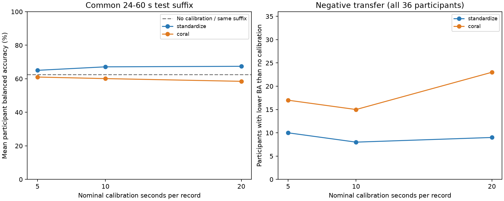
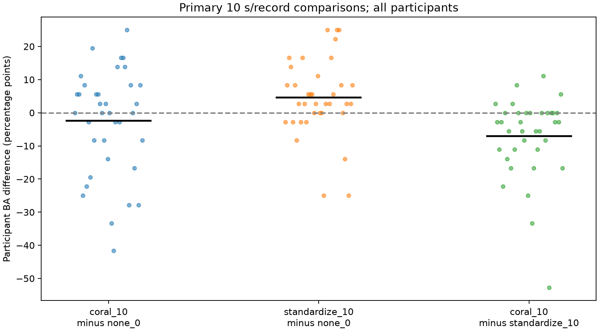
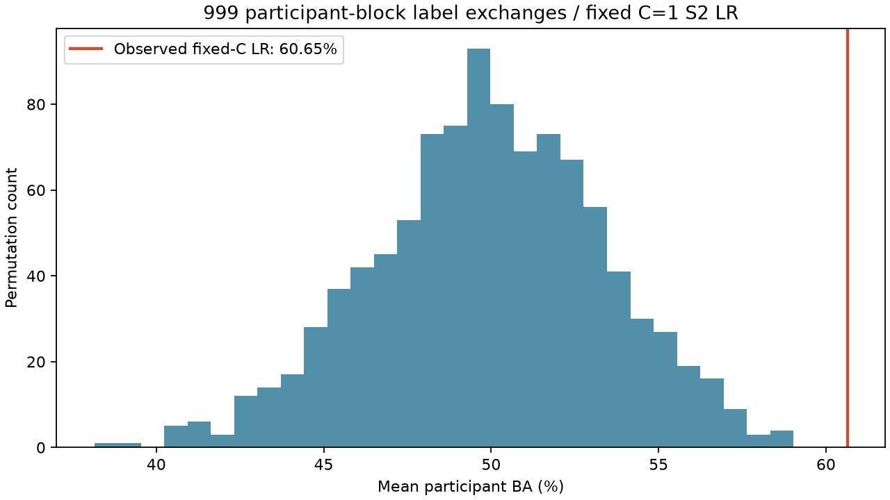
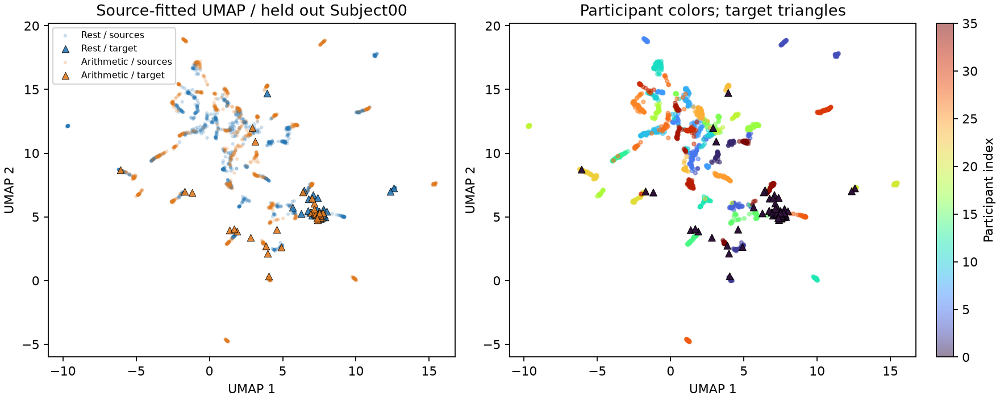
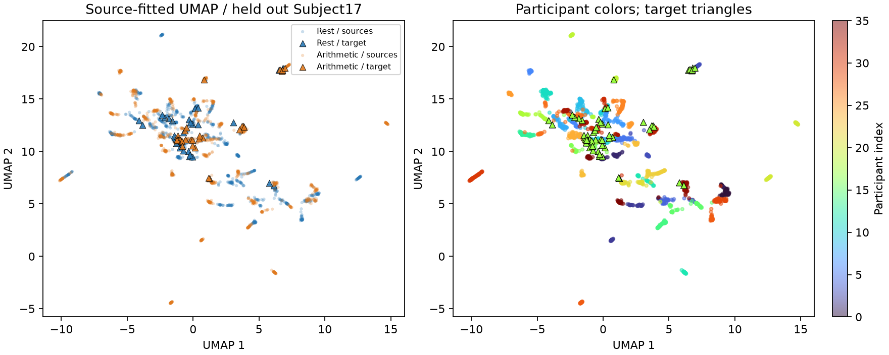
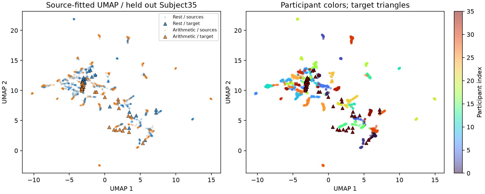
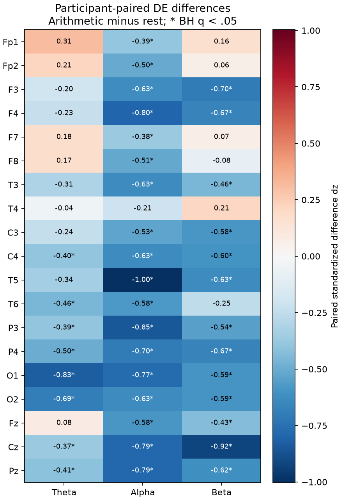
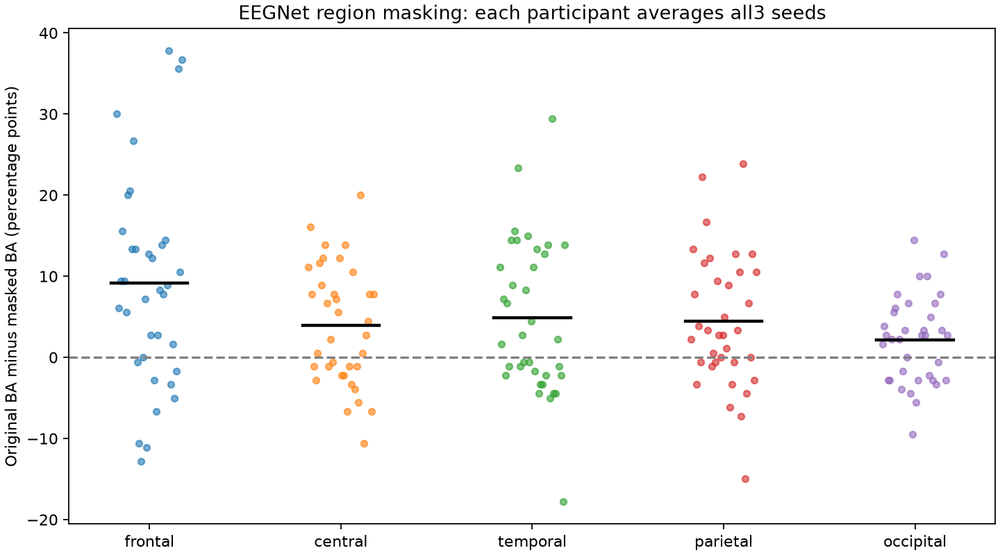
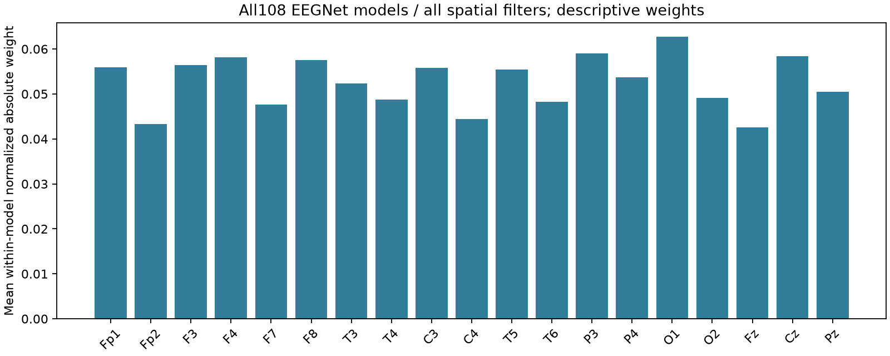

# Python V2 第四阶段：有限校准与完整分析

日期：2026-10-09。推荐完整版主线已完成；DANN、额外ICA和外部数据验证仍是明确未实施的扩展。见[事前冻结协议](v2-stage4-protocol.md)和[V2总报告](v2-final-report.md)。

## 实验范围与信息隔离

7配置×36人全部完成，252个最终模型/适配组合、9072条预测通过独立审计，最大重放误差为0。复用逐窗独立处理的128 Hz、2秒、57维DE；来源内部3折模拟目标校准并选LR的C，最后拟合35名来源者。适配器不接收目标标签或测试后缀。

| 每记录名义前缀预算 | 两记录实际使用秒数 | 合计校准窗 | 固定测试后缀 | 合计测试窗 |
|---:|---:|---:|---|---:|
| 0秒 | 0 | 0 | 每记录24—60秒 | 36 |
| 5秒 | 8 | 4 | 每记录24—60秒 | 36 |
| 10秒（主预算） | 20 | 10 | 每记录24—60秒 | 36 |
| 20秒 | 40 | 20 | 每记录24—60秒 | 36 |

5秒预算只使用完整2秒窗的4秒；两个记录边界及两条件均有前缀是划分先验。这是离线分块校准，不能推广为任意自然数据流的无监督适配。所有S3对照共享后缀，与S2整段60秒的分数分表解释。

CORAL采用事前登记的目标白化/来源着色方向，来源分类器保持固定坐标；对角标准化使用相同中心化和收缩规则。此为反向CORAL变体，在L2正则下不等同于原论文源到目标方向。短样本使用Ledoit–Wolf收缩与固定微小ridge，不按外层成绩调整方向、正则或预算。

## 全部校准结果

指标按36名被试等权平均；同一被试在不同预算下不是新增样本。

| 方法 / 每记录名义预算 | BA | macro-F1 | AUC | 比不校准下降人数 | 下降超过5百分点 |
|---|---:|---:|---:|---:|---:|
| 不校准 | 62.58% | 0.5761 | 0.7325 | — | — |
| 对角标准化 / 5秒 | 65.05% | 0.6288 | 0.7104 | 10 | 7 |
| 对角标准化 / 10秒 | 67.13% | 0.6542 | 0.7183 | 8 | 4 |
| 对角标准化 / 20秒 | 67.44% | 0.6677 | 0.7161 | 9 | 7 |
| 反向CORAL / 5秒 | 61.03% | 0.5826 | 0.6505 | 17 | 11 |
| 反向CORAL / 10秒 | 60.11% | 0.5824 | 0.6535 | 15 | 12 |
| 反向CORAL / 20秒 | 58.49% | 0.5717 | 0.6178 | 23 | 17 |

主预算的标准化BA为67.13%，与不校准相差+4.55个百分点；二者AUC分别为0.7183与0.7325。CORAL的BA为60.11%，与不校准相差-2.47个百分点，与标准化相差-7.02个百分点。保留全部预算和被试，不把负迁移隐藏为失败折。

结果解释限定在本数据、对齐方向与预算，不能推广为所有CORAL变体的结论。可能因素包括短校准估计误差、前后时段漂移和混合两条件协方差，但本实验未将这些解释逐一识别为因果。

## 主比较与不确定性

| 主预算配对比较 | BA平均差（百分点） | 条件性95%描述区间 | 原始符号翻转p | Holm p |
|---|---:|---|---:|---:|
| coral_10_minus_none_0 | -2.47 | [-7.64, +2.47] | 0.372016 | 0.372016 |
| standardize_10_minus_none_0 | +4.55 | [+0.77, +8.26] | 0.027400 | 0.054799 |
| coral_10_minus_standardize_10 | -7.02 | [-11.27, -3.40] | 0.000350 | 0.001050 |

5000次被试配对bootstrap与100000次符号翻转，种子42，Holm仅校正事前声明的3个主比较。标准化−不校准的Holm p为0.054799，CORAL−标准化的Holm p为0.001050。不能仅据未校正区间跨不过零而宣称确认性提升；LOSO训练集重叠、符号交换假设和单数据集探索性限制仍然适用。

## 固定LR的正式置换检验

固定C=1的DE128+LR、S2整段零校准基线BA为60.65%。每名被试整体交换或不交换两条件标签，999次置换全部完成，每次重新拟合36折，共计36,000次拟合（含原标签36折）。空分布均值为49.91%，不低于观察统计量的置换为0次，按加一公式p=0.001。

此p值依赖被试内整条件交换的可交换性，仅对应固定C流程，不对应嵌套选参LR、EEGNet或域适配模型；固定静息先于心算的顺序/记录混杂没有被消除。0.001是本次999次Monte Carlo检验的分辨率下限，不写成p<0.001。

## 分布与解释

三个预先指定目标的UMAP均在2100个来源窗口拟合，目标60窗只transform，来源标准化和嵌入状态通过核验。条件颜色存在广泛重叠、被试位置异质；这些是投影描述，不能用聚类图证明泛化或神经机制。

57个通道×频段以每人条件均值差为单位计算配对t区间、dz和BH-FDR，其中39项q<0.05。全部方向与数值公开，不能将其写成已验证生物标志物；顺序、记录和供应方清洗仍可能贡献差异。

108个EEGNet保存模型全部重放，5个预定义脑区分别在来源标准化后置零，共540次扰动；每人先平均3种子。

| 遮蔽脑区 | 平均BA损失（百分点） |
|---|---:|
| frontal | 9.14 |
| central | 3.97 |
| temporal | 4.86 |
| parietal | 4.43 |
| occipital | 2.19 |

脑区包含的通道数不同，置零可能产生分布外信号；损失较大不等于该脑区有更强因果作用。空间权重汇总跨全部滤波器和模型的归一化绝对值，未经跨种子滤波器对齐，也不是脑激活图。

## 复核、成本与完成边界

全部162项测试通过。独立审计复算校准预测、候选均值、置换计数、配对校正与特征统计，核对3个UMAP来源拟合、108模型与540扰动汇总；固定索引0/1/42/999重拟合置换结果一致。校准组合最终拟合耗时中位数为0.0144秒，36窗预测中位数为0.000510秒；不含源侧选参和数据准备，实测硬件为CPU，不能当作通用性能承诺。

最终审计脚本首次在Windows大小写不敏感的路径匹配中误将subject_metrics.csv视为被试目录；已限制为目录并通过复核。实验算法、冻结方案和结果没有改变。

推荐完整版主线已经完成。DANN需另行建立同骨干λ=0对照、全部种子和源侧适配选择，不为增加算法名称并入本轮；额外ICA和外部数据验证仍作为扩展。原始EDF、MAT、环境、窗口数组和模型留在本地，发布轻量预测、统计、配置、代码与图表。

[独立审计](../results/v2-stage4/independent_audit.json)｜[测试记录](../results/v2-stage4/tests.xml)｜[结果状态](../results/v2-stage4/status.json)｜[复现说明](../python-v2/README.md#第四阶段复现)
